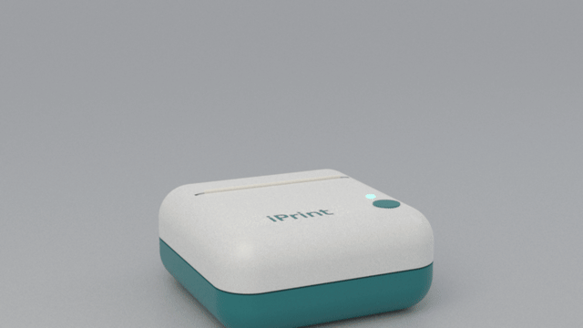
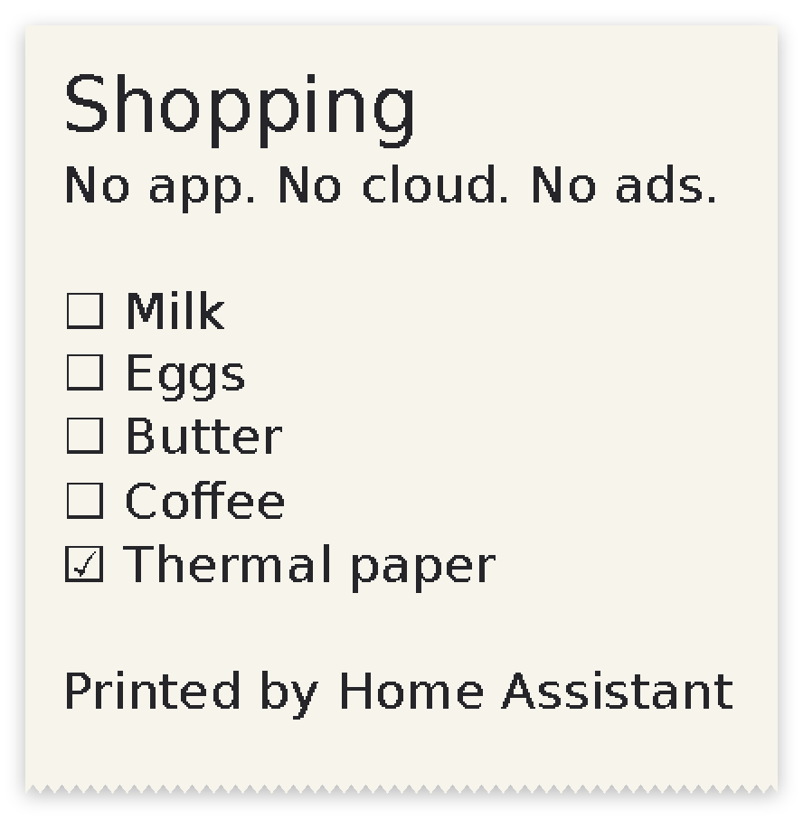
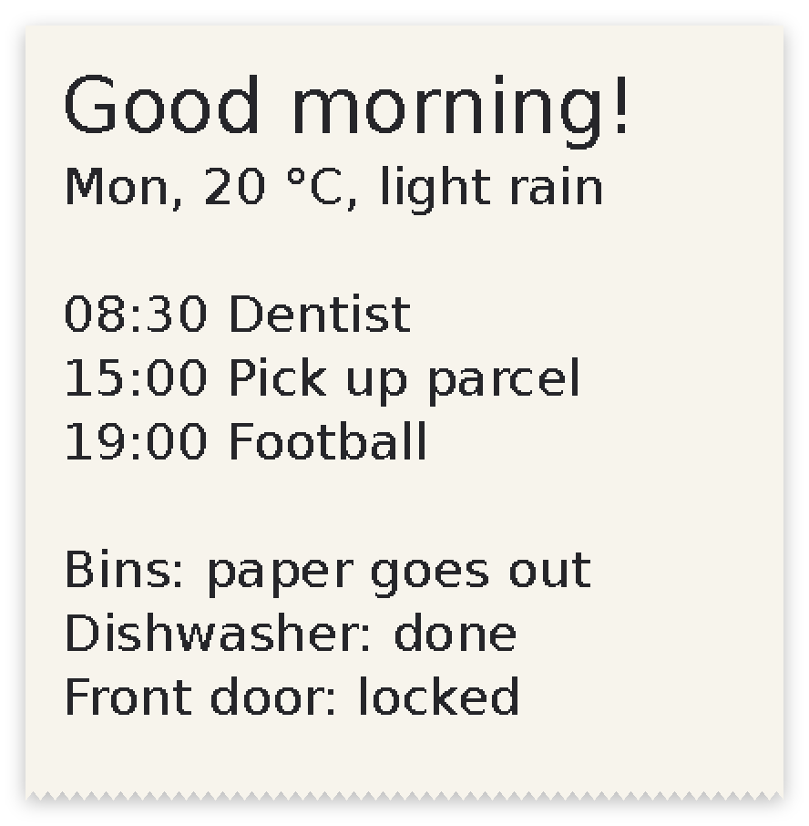
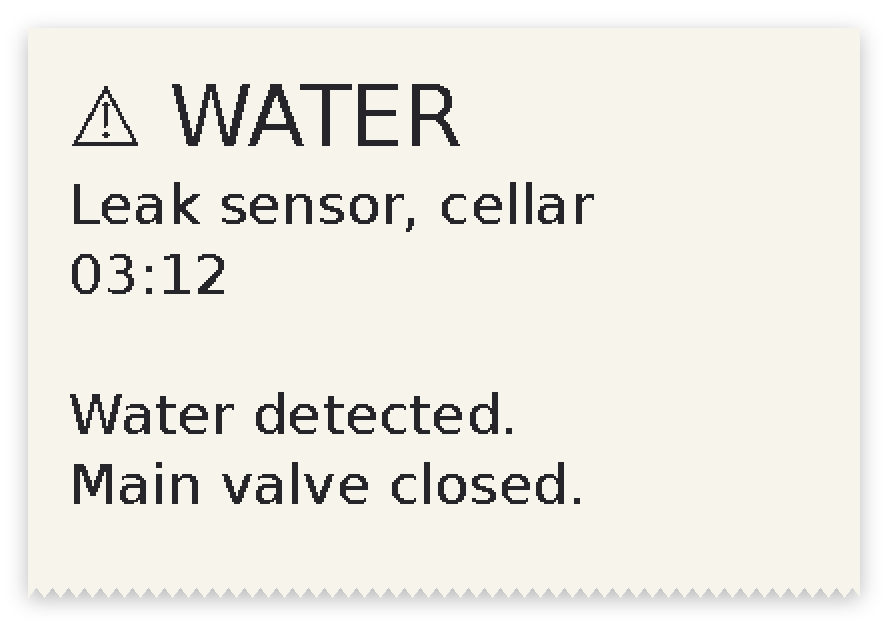
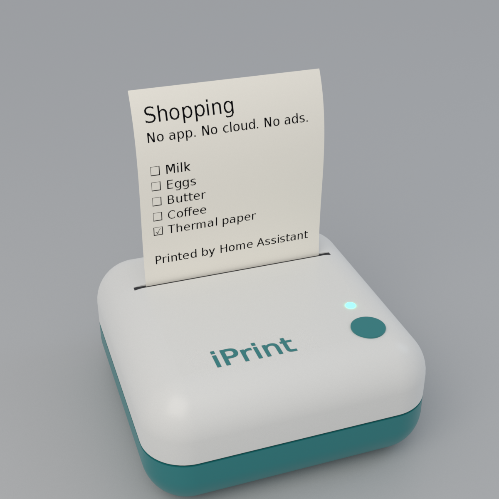
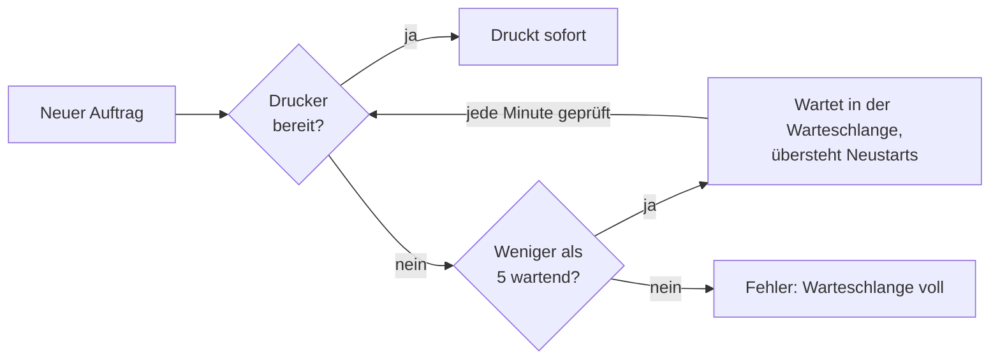
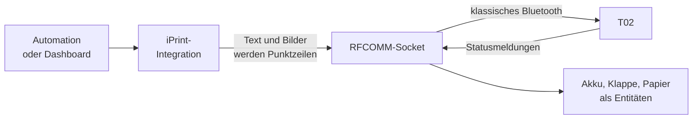

<p align="center"></p>

<h1 align="center">iPrint</h1>

<p align="center"><b>Dein Phomemo-T02-Thermodrucker, befreit.</b><br>
Drucken aus Home Assistant. Ohne App, ohne Konto, ohne Cloud, ohne Werbung.</p>

<p align="center">
  
  
  
  
</p>

<p align="center"></p>

<p align="center"><sub>Eine gerenderte Illustration, kein Produktfoto. Der Text auf dem Papier ist die echte Ausgabe dieser Integration.</sub></p>

<p align="center"><a href="README.md">English</a> · <a href="docs/RECIPES.md">Rezepte</a> · <a href="docs/PROTOCOL.md">Protokoll</a> · <a href="docs/WHY.md">Warum es das gibt</a></p>

## Warum

Der T02 ist eine einfache Maschine: 48 Bytes pro Punktzeile über eine serielle Bluetooth-Verbindung. Offiziell lässt er sich nur
über die Handy-App des Herstellers nutzen, einen 134-MB-Download mit Werbesystem, Bezahlstufen, fünf KI-Funktionen und drei
Tracking-Baukästen. [Die Belege und ein Skript zum Selbstnachzählen stehen hier.](docs/WHY.md)

iPrint ersetzt das durch weniger als 1000 Zeilen Python, die direkt mit dem Drucker sprechen und mit niemandem sonst.

## Was es kann

| | |
|---|---|
| 🧾 **Drucken aus jeder Automation** | `notify.send_message` druckt. Alles, was dich benachrichtigen kann, bringt es jetzt auch aufs Papier. |
| ✍️ **Text** | Zeilenumbruch, Überschrift, Größe und Druckstärke. Umlaute, €, Pfeile und Kästchen kommen richtig heraus. |
| 🖼️ **Bilder** | Auf Papierbreite skaliert und für den Thermodruck gerastert. |
| 🔎 **Kennt den Zustand** | Akku, Klappe, Papier und Warteschlange als Entitäten in Home Assistant. |
| 🕓 **Wartet auf den Drucker** | Drucker aus, Klappe offen oder Rolle leer? Bis zu 5 Aufträge warten und drucken von selbst, sobald es geht, auch nach einem Neustart von Home Assistant. |
| ✅ **Ehrlich beim Ergebnis** | Ein Druck gilt erst als fertig, wenn der Drucker das meldet. Eine volle Warteschlange ist ein Fehler, nie ein lautlos verlorener Auftrag. |
| 🛡️ **Sicher voreingestellt** | Bei 4000 Zeilen (etwa 50 cm) ist Schluss, damit eine fehlgeleitete Automation nicht die Rolle leert. |

## Was du drucken kannst

<table>
<tr>
<td align="center"><br><sub>Einkaufsliste</sub></td>
<td align="center"><br><sub>Morgenzettel</sub></td>
<td align="center"><br><sub>Alarm auf Papier</sub></td>
</tr>
<tr>
<td align="center"><br><sub>Etikett</sub></td>
<td align="center"><br><sub>Bild, gerastert</sub></td>
<td align="center"><br><sub>Gerendertes Modell</sub></td>
</tr>
</table>

<sub>Das sind genau die Punkte, die der Code an den Drucker schickt, erzeugt mit <code>tools/render/samples.py</code>. Automationen dazu stehen in den <a href="docs/RECIPES.md">Rezepten</a>.</sub>

## Schnellstart

**Du brauchst** einen Bluetooth-Adapter mit klassischem Bluetooth (BR/EDR) an dem Rechner, auf dem Home Assistant läuft.
ESPHome-Bluetooth-Proxys gehen nicht, weil sie nur BLE weiterleiten. Getestet auf Home Assistant OS.

1. `custom_components/iprint` nach `config/custom_components` kopieren oder dieses Repository in HACS als benutzerdefiniertes
   Repository eintragen. Danach Home Assistant neu starten.
2. Drucker einschalten. Auf dem Home-Assistant-Host die Adresse suchen:
   ```
   bluetoothctl scan bredr
   ```
   Gesucht ist ein Gerät namens `T02`. Eine Kopplung ist nicht nötig.
3. **Einstellungen → Geräte & Dienste → Integration hinzufügen → iPrint** öffnen und die Adresse eintragen.
4. Drucken:
   ```yaml
   action: notify.send_message
   target:
     entity_id: notify.phomemo_t02_drucken
   data:
     title: Hallo
     message: Gedruckt von Home Assistant
   ```

Die Entitätsnamen folgen der Sprache deines Home Assistant. Auf Englisch heißt die obige `notify.phomemo_t02_print`.

## Aktionen

| Aktion | Felder | |
|---|---|---|
| `notify.send_message` | `message`, `title` | Text drucken. |
| `iprint.print_text` | `text`, `title`, `size`, `density` | Text mit allen Optionen drucken. |
| `iprint.print_image` | `path`, `density` | Bild drucken. Der Ordner muss in [`allowlist_external_dirs`](https://www.home-assistant.io/integrations/homeassistant/#allowlist_external_dirs) stehen. |
| `iprint.feed` | | Papier vorschieben. |
| `iprint.clear_queue` | | Alle wartenden Aufträge entfernen. |

## Die Warteschlange



Du kannst also einen Auftrag schicken und den Drucker später einschalten. Etwa eine Minute nach dem Einschalten kommen wartende
Aufträge in der Reihenfolge ihres Eingangs. Eine Aktion an einen abwesenden Drucker gilt deshalb als erfolgreich, sobald der Auftrag
in der Warteschlange liegt: Der Sensor **Warteschlange** zeigt, was wartet, **Warteschlange leeren** entfernt es. Ein Auftrag, der
mittendrin die Verbindung verliert, wird nicht wiederholt, weil er sonst doppelt käme. Er steht stattdessen im Protokoll.

## Wie es funktioniert



Der Bluetooth-Teil von Home Assistant spricht nur BLE, der T02 druckt nur über klassisches Bluetooth. Deshalb öffnet iPrint aus
Home Assistant heraus einen gewöhnlichen Linux-RFCOMM-Socket. Mehr braucht es nicht: kein Add-on, kein Zusatzgerät.

Die Verbindung bleibt offen, wie in der Handy-App, denn dieser Drucker lehnt nach jedem Trennen eine Weile neue Verbindungen ab.
Gemessen: Eine gehaltene Verbindung beantwortete 12 von 12 Statusabfragen und druckte sofort, Neuverbinden im Abstand weniger
Sekunden klappte 3 von 15 Mal.

Das ganze Protokoll steht in [docs/PROTOCOL.md](docs/PROTOCOL.md), auch was am echten Drucker gemessen und was nur aus der App
gelesen wurde.

## Gut zu wissen

- **Getestet mit einem Drucker:** ein T02 mit Firmware 1.0.0. Andere Phomemo-Modelle nutzen eventuell andere Befehle. Berichte sind willkommen.
- **Die Handy-App kann nicht gleichzeitig verbinden,** weil der Drucker nur einen Client annimmt. Für die App die Integration in
  Home Assistant deaktivieren.
- **Der Drucker schläft** nach einiger Zeit ohne Kontakt ein. Sein Funkmodul nimmt dann weiter Verbindungen an, aber nichts
  antwortet. Aufträge warten in der Warteschlange, bis du den Drucker aus- und wieder einschaltest.
- **Sensoren stehen auf *nicht verfügbar***, solange der Drucker aus ist. Das ist normal.
- **Der Akkuwert springt**, wenn das Ladegerät eingesteckt wird. Er ist nur ein grober Anhaltspunkt.

## Entwicklung

```
pip install pytest pillow
pytest
```

Die Tests nutzen Antworten eines echten Druckers und einen geskripteten Socket, der die dort beobachteten Fehler nachstellt. Alle
Bilder dieses README lassen sich aus dem Quelltext neu bauen: siehe [tools/render](tools/render/README.md). Beiträge sind willkommen:
siehe [CONTRIBUTING.md](CONTRIBUTING.md).

## Credits

*Ideas by BLOTTO, vibed by OPUS.*

MIT-Lizenz. Enthält DejaVu Sans, siehe [`fonts/LICENSE`](custom_components/iprint/fonts/LICENSE). Keine Verbindung zu Phomemo.
„Phomemo“ und „T02“ stehen hier nur, um zu sagen, mit welchem Drucker das funktioniert.
