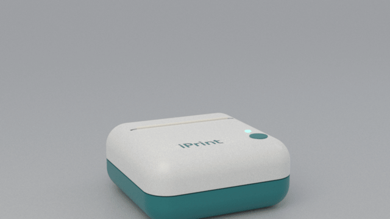
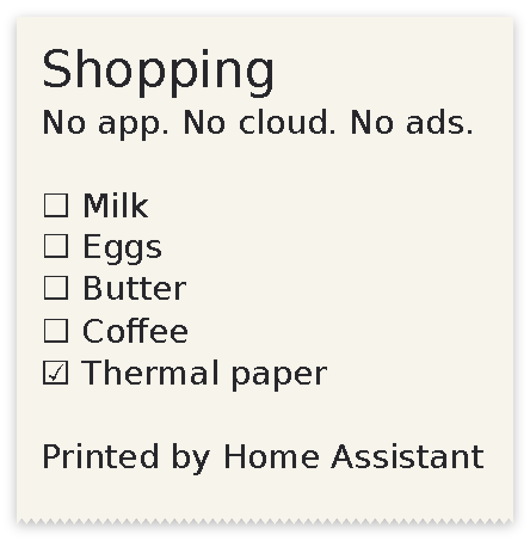
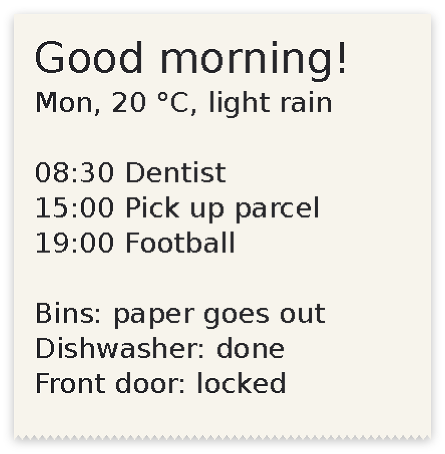
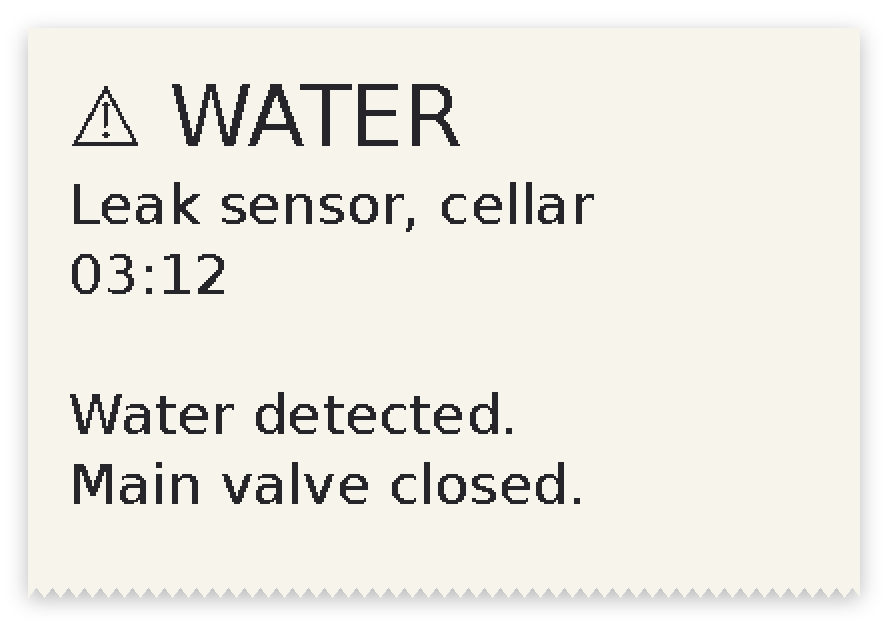
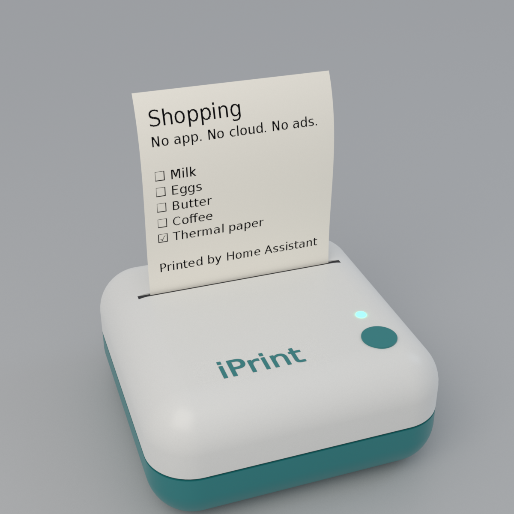
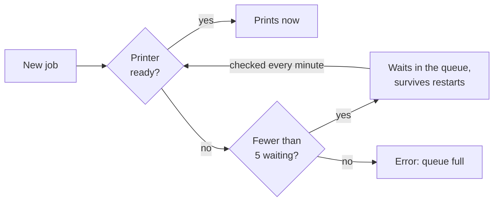
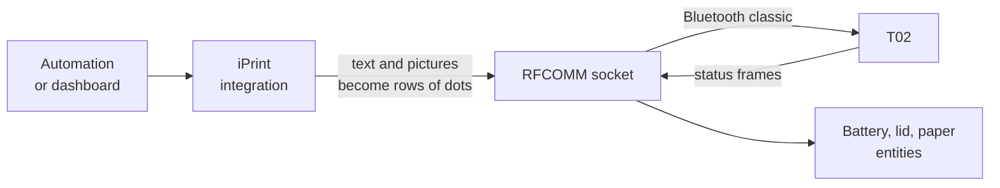

<p align="center"></p>

<h1 align="center">iPrint</h1>

<p align="center"><b>Your Phomemo T02 thermal printer, set free.</b><br>
Print from Home Assistant. No app, no account, no cloud, no ads.</p>

<p align="center">
  
  
  
  
</p>

<p align="center"></p>

<p align="center"><sub>A rendered illustration, not a product photo. The text on the paper is the real output of this integration.</sub></p>

<p align="center"><a href="README.md">Deutsch</a> · <a href="docs/RECIPES.md">Recipes</a> · <a href="docs/PROTOCOL.md">Protocol</a> · <a href="docs/WHY.md">Why this exists</a></p>

## Why

The T02 is a simple machine: 48 bytes per row of dots over a serial Bluetooth link. Officially, you can only use it through
the vendor's phone app, a 134 MB download that ships with an advertising system, paid tiers, five AI features and three
tracking kits. [The evidence, and a script to count it yourself, is here.](docs/WHY.md)

iPrint replaces all of that with under 1000 lines of Python that talk to the printer directly and to nothing else.

## What it does

| | |
|---|---|
| 🧾 **Print from any automation** | `notify.send_message` prints. Anything that can notify you can now put it on paper. |
| ✍️ **Text** | Word wrap, title, size and darkness. Umlauts, €, arrows and checkboxes print properly. |
| 🖼️ **Pictures** | Scaled to the paper and dithered for thermal print. |
| 🔎 **Knows the printer's state** | Battery, lid, paper and the queue as Home Assistant entities. |
| 🕓 **Waits for the printer** | Printer off, lid open or roll empty? Up to 5 jobs wait and print by themselves when it is ready, even after a Home Assistant restart. |
| ✅ **Honest about results** | A job only counts as done when the printer reports it. A full queue is an error, never a silently lost job. |
| 🛡️ **Safe by default** | Jobs stop at 4000 rows (about 50 cm), so a runaway automation cannot empty the roll. |

## What you can print

<table>
<tr>
<td align="center"><br><sub>Shopping list</sub></td>
<td align="center"><br><sub>Morning summary</sub></td>
<td align="center"><br><sub>Alarm on paper</sub></td>
</tr>
<tr>
<td align="center"><br><sub>Label</sub></td>
<td align="center"><br><sub>Picture, dithered</sub></td>
<td align="center"><br><sub>Rendered model</sub></td>
</tr>
</table>

<sub>These are the exact dots the code sends to the printer, generated by <code>tools/render/samples.py</code>. Automations for them are in the <a href="docs/RECIPES.md">recipes</a>.</sub>

## Quick start

**You need** a Bluetooth adapter that does classic Bluetooth (BR/EDR) on the machine running Home Assistant.
ESPHome Bluetooth proxies will not work, because they only carry BLE. Tested on Home Assistant OS.

1. Copy `custom_components/iprint` to your `config/custom_components`, or add this repository to HACS as a custom
   repository. Then restart Home Assistant.
2. Switch the printer on. On the Home Assistant host, find its address:
   ```
   bluetoothctl scan bredr
   ```
   Look for a device named `T02`. No pairing is needed.
3. Go to **Settings → Devices & services → Add integration → iPrint** and enter the address.
4. Print:
   ```yaml
   action: notify.send_message
   target:
     entity_id: notify.phomemo_t02_print
   data:
     title: Hello
     message: Printed by Home Assistant
   ```

Entity names follow your Home Assistant language. In German, the one above is `notify.phomemo_t02_drucken`.

## Actions

| Action | Fields | |
|---|---|---|
| `notify.send_message` | `message`, `title` | Print text. |
| `iprint.print_text` | `text`, `title`, `size`, `density` | Print text with all the options. |
| `iprint.print_image` | `path`, `density` | Print a picture. The folder must be in [`allowlist_external_dirs`](https://www.home-assistant.io/integrations/homeassistant/#allowlist_external_dirs). |
| `iprint.feed` | | Advance the paper. |
| `iprint.clear_queue` | | Remove all waiting jobs. |

## The queue



So you can send a job and switch the printer on later. Within about a minute of switching on, waiting jobs print in the
order they came in. An action on a printer that is away therefore succeeds as soon as the job is queued: the **Print queue**
sensor shows what is waiting, and **Clear print queue** removes it. A job that loses its connection halfway is not repeated,
because it could print twice. It is reported in the log instead.

## How it works



Home Assistant's Bluetooth stack only speaks BLE, and the T02 only prints over Bluetooth classic. So iPrint opens a plain
Linux RFCOMM socket from inside Home Assistant. There is nothing else to install, no add-on and no extra device.

The connection stays open, as it does in the phone app, because this printer refuses new connections for a while after
each disconnect. Measured: one held connection answered 12 of 12 status requests and printed at once, while reconnecting
every few seconds succeeded 3 times in 15.

The whole protocol is written down in [docs/PROTOCOL.md](docs/PROTOCOL.md), including what was measured on a real printer
and what was only read from the app.

## Good to know

- **Tested on one printer:** a T02 with firmware 1.0.0. Other Phomemo models may use other commands. Reports welcome.
- **The phone app cannot connect at the same time,** because the printer takes one client at a time. Disable the
  integration in Home Assistant to use the app.
- **The printer falls asleep** after a while without contact. Its radio then still accepts connections, but nothing
  answers. Jobs wait in the queue until you switch the printer off and on.
- **Sensors show *unavailable*** while the printer is off. That is normal.
- **The battery reading jumps** when the charger is plugged in, so treat it as a rough guide.

## Development

```
pip install pytest pillow
pytest
```

The tests use frames read off a real printer, and a scripted socket that reproduces the failures seen on one. The images
in this README can all be rebuilt from source: see [tools/render](tools/render/README.md). Contributions are welcome:
see [CONTRIBUTING.md](CONTRIBUTING.md).

## Credits

*Ideas by BLOTTO, vibed by OPUS.*

MIT licensed. Includes DejaVu Sans, see [`fonts/LICENSE`](custom_components/iprint/fonts/LICENSE). Not affiliated with
Phomemo. "Phomemo" and "T02" are used only to say which printer this works with.
