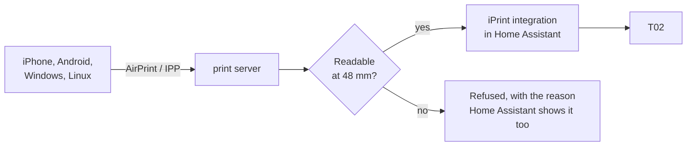

# iPrint print server (beta)

> **Beta, and entirely optional.** The Home Assistant integration works on its own. You only need this container if you
> want to print from a phone or computer through its normal print dialog.

It makes the T02 a network printer: AirPrint on Apple devices, and IPP Everywhere / Mopria on Android, Windows and Linux.
Unlike a normal printer, **it refuses what you could not read.**



## What gets refused

| You send | Result |
|---|---|
| A photo | Prints, dithered. Landscape is turned to fill the paper. |
| A label or a page with large text | Prints. Empty margins are cut first, so a small label on a big page is fine. |
| A normal A4 letter | **Refused.** "Text would be too small. About 0.9 mm high, 1.4 mm needed." |
| More than 5 pages, or longer than 50 cm | Refused. |

The check runs OCR on what you sent, then does two things:

1. **Size.** A word must come out at least 1.4 mm high (11 dots). That is the usual minimum for reading at 30 cm. Up to
   20 % of the words may be smaller, so fine print does not sink a page.
2. **Read-back.** OCR must find at least 60 % of the words again in the final black-and-white dots.

A page with little or no text counts as a picture and always prints. A page that OCR cannot check is refused, never
printed unchecked.

## Shipping labels

Pick **iPrint PHOMEMO shipping label** in the print dialog. A carrier label is about 100 mm wide, the paper 48 mm, and
shrinking it makes Code 128 unreadable: in tests, every Code 128 failed at 0.18 mm per bar. So nothing is shrunk:

- Every code is taken over from the PDF as it is, at a size where each bar is a whole number of printer dots, never
  smaller than on the original (at least 0.375 mm), with bars at least 25 mm tall and 8 mm of white beside them. A code
  wider than the paper is turned. A UPS MaxiCode keeps its fixed size.
- Codes are not re-encoded: an encoder dropped GS1 without a word in tests. After printing, every code is read back and
  must give the same format, symbology identifier and bytes, or the job is refused.
- A **return PDF** is taken apart into slips with cut lines: the label with its addresses, a QR code for the shop with
  its identifier printed above it, and the code to put inside the parcel.
- If the PDF offers both a **shop QR code** and a **label to print yourself**, it prints the shop QR code with its
  identifier. With questions on (`IPRINT_ASK`, below), the job waits instead: Home Assistant shows a notification (and a
  push if set up) with a link to a page that previews both ways, with a box for the identifiers.

> ⚠️ Not every carrier allows a changed label. DHL rules out scaling and changed labels explicitly and may charge for a
> code it cannot read. The shop QR code is the official way. Test one parcel per carrier before you rely on this.

## Photos

Photos print at once. With questions on (`IPRINT_ASK`), a photo on **iPrint PHOMEMO** waits for a little editing
instead: dots or hard edges, brightness, contrast, turn, width and cropping. The preview shows the printer's own dots.
Text documents always print straight away.

> Questions are off by default since 0.2.0b3. A job that waits for a page nobody opens never prints, and the push to the
> phone that sent the job is not built yet.

## Setup

1. In Home Assistant: **Settings → Devices & services → iPrint → Configure**, switch on **Accept jobs from the print
   server**, and note the address shown. To get questions on your phone, enter its notify action there, for example
   `notify.mobile_app_my_phone`. This webhook can only print, and it only answers on your local network.
2. Build the image and put the full address in a file:
   ```
   docker build -t iprint_druckdienst printserver
   echo "http://HOME-ASSISTANT:8123/api/webhook/YOUR-ID" > webhook_url
   ```
3. Run it with its own address on your network, because phones find printers by multicast:
   ```yaml
   services:
     printserver:
       image: iprint_druckdienst
       user: "99:100"
       cap_drop: [ALL]
       security_opt: ["no-new-privileges:true"]
       read_only: true
       tmpfs: [/tmp]
       sysctls:
         net.ipv4.ip_unprivileged_port_start: "631"
       environment:
         IPRINT_ADDRESS: 192.168.1.50      # this container's address
         IPRINT_LANGUAGE: en               # or de
        IPRINT_ASK: "0"                   # "1": choice page for returns, editor for photos (preview)
         IPRINT_WEBHOOK_FILE: /run/webhook_url
       volumes:
         - ./webhook_url:/run/webhook_url:ro
       networks:
         lan:
           ipv4_address: 192.168.1.50
   networks:
     lan:
       external: true    # a macvlan network on your LAN
   ```

## Good to know

- **Anyone on your network can print**, as with most printers. There is no login.
- **How a refusal appears depends on the client,** and a phone may only show a generic error. The reason is always in a
  Home Assistant notification and in the event `iprint_job_refused`.
- **Phones must be on the same network** to find it. Multicast does not cross subnets.
- **No encryption:** jobs travel unencrypted over your local network.

## Tested so far

| | |
|---|---|
| CUPS tools on Linux (`ipptool`, `driverless`) | works |
| Full path to Home Assistant's queue | works |
| iPhone, Android, Windows | **not yet tested** |
| Shipping labels, made-up ones of six carriers, simulated print | every code reads back identically |
| Shipping labels on real paper, scanned by a carrier | **not yet tested** |

Reports are very welcome.

## Development

Tests run against real Tesseract, so run them in the image:

```
docker run --rm --user 0 --entrypoint sh -v "$PWD/printserver/tests:/app/tests:ro" iprint_druckdienst \
  -c "pip install -q pytest && cd /app && python -m pytest tests"
```
